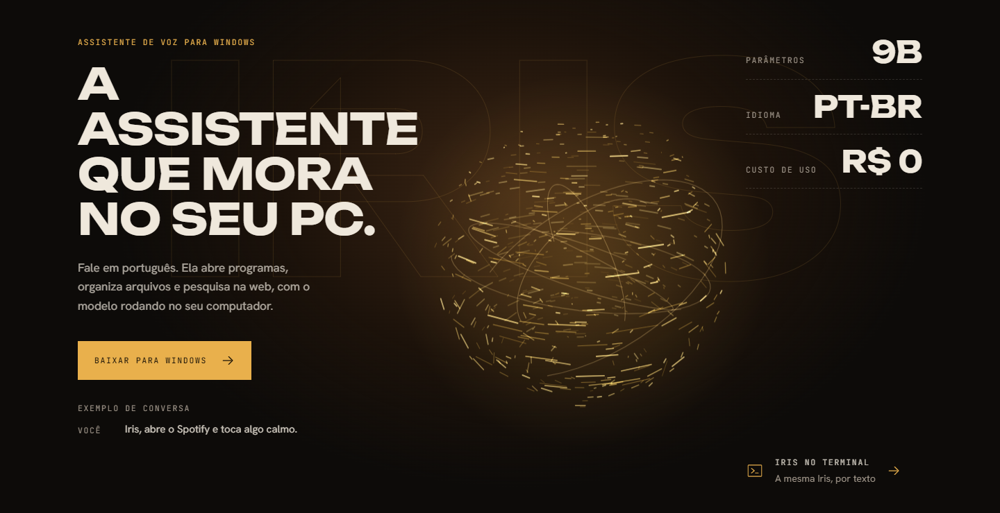
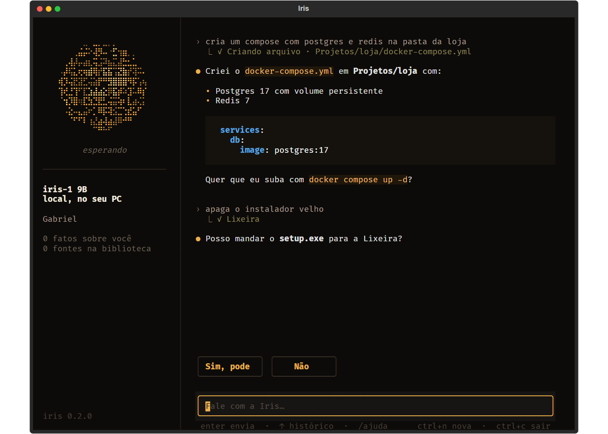
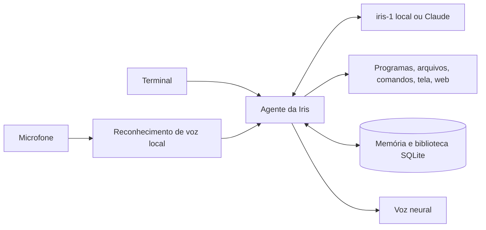

<p align="center">
  
</p>

<h1 align="center">Iris</h1>

<p align="center">
  <b>A assistente de voz e de terminal que mora no seu PC.</b><br>
  Em português, com o modelo próprio <b>iris-1</b> rodando no seu computador.
</p>

<p align="center">
  
  
  
  
</p>

<p align="center">
  <a href="#instalação">Instalação</a> ·
  <a href="#também-no-terminal">Terminal</a> ·
  <a href="#o-modelo-iris-1">Modelo iris-1</a> ·
  <a href="docs/arquitetura.md">Arquitetura</a> ·
  <a href="../../releases">Releases</a>
</p>

<p align="center">
  
</p>

---

## Fale do jeito que você fala

Chame **“Iris”** (ou “bom dia, Iris”) e peça. Ela age sem narrar cada passo e só pergunta antes do que não dá para desfazer.

| Você diz | A Iris |
|---|---|
| “Abre o VS Code e fecha o Teams” | Abre, fecha e confirma em poucas palavras |
| “Qual a cotação do dólar hoje?” | Pesquisa na web, lê as páginas e responde com a fonte |
| “Apaga os instaladores velhos dos Downloads” | Mostra quais são e só manda para a Lixeira depois do seu sim |
| “Aprende esse site” | Lê a página aberta no navegador e guarda na biblioteca |
| “Faz uma lista de compras na Área de Trabalho” | Cria o arquivo e diz onde salvou |
| “Clica no segundo vídeo” | Olha a tela e clica |
| “Lembra que eu moro em Recife” | Guarda e usa nas próximas conversas |

Pedidos com conteúdo sexual, racismo ou ódio são recusados.

## Também no terminal

<p align="center">
  
</p>

```powershell
iris                                        # abre o terminal da Iris
iris "explica como funciona o imposto de renda"
iris library learn https://docs.docker.com/compose/
iris memory list
```

No terminal, `/ajuda` mostra os comandos: `/nova`, `/memoria`, `/lembrar`, `/biblioteca`, `/aprender`.

## Sua, de verdade

| Fica no seu PC | Vai para a internet só quando precisa |
|---|---|
| O modelo iris-1, que entende e responde | Pesquisas na web que você pede |
| Conversas e o que ela aprende sobre você | Páginas que você manda ela aprender |
| Arquivos, pastas e a biblioteca de sites salvos | O texto que ela fala, para gerar a voz neural |
| O áudio do microfone (o reconhecimento de voz é local) | Mensagens para o Claude, se você escolher usar sua chave |

A biblioteca usa busca híbrida (por palavra e por significado) num banco SQLite local. A pesquisa na web usa Tavily, Brave ou um SearXNG seu, com o DuckDuckGo como reserva.

## Escolha pela sua placa de vídeo

<p align="center">
  
</p>

| Versão | Placa de vídeo | Download aproximado |
|---|---|---|
| **iris-1 9B** (completa) | 8 GB ou mais | 6 GB |
| iris-1 4B | 4 a 6 GB | 3 GB |
| iris-1 2B | não precisa | 1,5 GB |

Prefere não usar a placa? Informe sua chave da API da Anthropic e a Iris responde com o Claude.

## Instalação

> O instalador e o executável da CLI ainda não foram publicados. Acompanhe as [releases](../../releases). Até lá, rode a partir do código:

```powershell
git clone https://github.com/GabrielKLopes/iris.git
cd iris
py -3.12 -m venv .venv
.\.venv\Scripts\python.exe -m pip install -e ".[dev]"
cd frontend; npm install; npm run build; cd ..
.\.venv\Scripts\iris.exe setup      # seu nome, a chave e o buscador
.\.venv\Scripts\iris.exe            # terminal
.\.venv\Scripts\python.exe -m iris  # desktop, a esfera com voz
```

## Como funciona



A arquitetura e as decisões estão em [docs/arquitetura.md](docs/arquitetura.md).

## O modelo iris-1

O iris-1 é o **Qwen3.5** ajustado com LoRA em conversas no estilo da Iris: falar curto, usar as ferramentas certas, pedir confirmação e entender português falado. O notebook [`notebooks/train_iris_colab.ipynb`](notebooks/train_iris_colab.ipynb) treina no Google Colab ou numa GPU alugada, salva o progresso no Drive e exporta o modelo pronto para rodar local. Detalhes em [docs/treino.md](docs/treino.md).

## Em breve

- [ ] Instalador para Windows e `iris.exe`
- [ ] Motor embutido, sem precisar instalar o Ollama
- [ ] E-mail, agenda e WhatsApp, sempre pedindo confirmação antes de enviar
- [ ] Aprendizado contínuo com as suas avaliações

## Licença

[MIT](LICENSE). O modelo base Qwen3.5 tem a própria licença, que acompanha os arquivos do iris-1.
